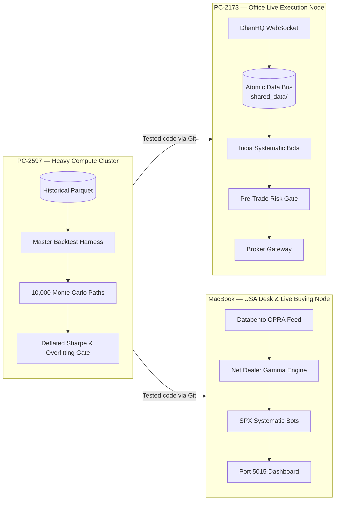

# Prince Chauhan

Senior Quantitative Researcher & Systematic Derivatives Desk Lead — New Delhi, India.  
SEBI Registered Research Analyst · 9+ Years Derivatives Architecture · ~₹50 Cr Notional Capacity

---

## 🏛️ Executive Summary

I architect and operate an institutional systematic options desk spanning Indian index derivatives (NSE Nifty, Bank Nifty, BSE Sensex) and USA volatility products (CBOE SPX, CME futures). 

With 9+ years on derivatives desks (SMC Global Securities, Smart Bulls Capital), my quantitative models manage ~₹50 Cr notional capacity with strict pre-trade risk controls, dynamic freeze-order slicing, and non-negotiable friction deductions on every leg.

- **Public Research Showcase**: **[`quant-research-portfolio`](https://github.com/prince-chauhan-pc/quant-research-portfolio)** — Tested Python implementations of production methods (SVI volatility surfaces, Johansen basket cointegration, K-means regime filters, execution latency simulation, and Deflated Sharpe overfitting gates).
- **Curriculum Vitae**: **[Download Institutional CV (PDF)](https://github.com/prince-chauhan-pc/quant-research-portfolio/blob/main/docs/PC_CV/Prince%20Chauhan%20-%20Senior%20Quant%20Researcher%20and%20Trader.pdf)**.

---

## 🌐 Dual-Market Infrastructure

The desk operates across two continuous sessions:

| Market | Operating Window (IST) | Core Products | Primary Feeds & Gateway |
|---|---|---|---|
| **India Desk** | 08:50 – 15:45 IST | Nifty 50, Bank Nifty, Sensex F&O | DhanHQ API v2 WebSocket, PreTrade RMS, Rule L25 Exit Escalator |
| **USA Desk** | 18:30 – 03:00 IST | CBOE SPX 0DTE/Multiday, CME ES/NQ | Databento OPRA L3 tick streams, Live GEX / Net Dealer Gamma |

---

## 🖥️ Workstation Topology

---

## 🔬 Core Quantitative Invariants

1. **Non-Negotiable Friction Drag**: Every simulation charges a minimum 0.50% premium turnover friction on entry and exit legs before calculating metrics.
2. **Strict Intraday Capital Preservation (Rule L25)**: Intraday options positions face a 3-stage forced exit escalator starting at 15:20:00 IST to prevent overnight gap risk.
3. **No-Lookahead Guarantee**: Volatility regime sizing strictly enforces a one-bar lag. Zero contemporaneous information leakage.
4. **Exchange Freeze Slicing**: Automated order slicing across exchange freeze limits (1,800 Nifty / 900 Bank Nifty / 1,000 Sensex) with inter-slice pacing.
5. **Overfitting Deflation**: Backtest performance is audited against Bailey & Lopez de Prado's Deflated Sharpe Ratio (DSR) and Combinatorial Symmetric Cross-Validation (CSCV/PBO).

---

## 🛠️ Tech Stack

- **Core**: Python 3.12 (NumPy, SciPy, pandas, Polars).
- **Execution & Feeds**: asyncio, WebSockets, DhanHQ API v2, Databento L3 OPRA, Alpaca.
- **Data & Telemetry**: DuckDB, SQLite, Parquet, Flask, ReportLab PDF Tearsheets.
- **Testing & Risk**: pytest, unittest, GitHub Actions CI, Pre-Trade Risk Engine.

---

## 📬 Contact & Verification

- **Email**: pchauhanrajput.pc@gmail.com
- **LinkedIn**: [linkedin.com/in/prince-chauhan-quant](https://www.linkedin.com/in/prince-chauhan-quant/)
- **Location**: New Delhi, India
